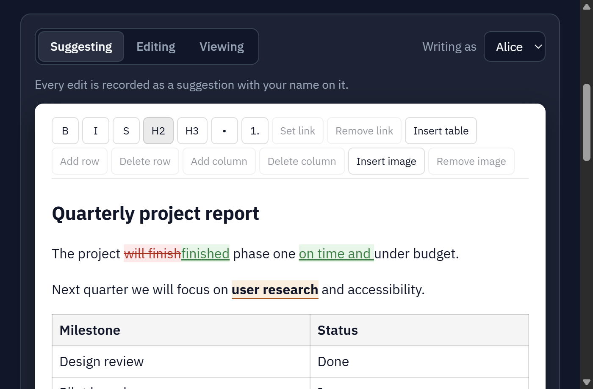

# track-changes

**Word-style tracked changes for the web — free, open source, framework-agnostic.**

Add "Suggesting mode" to any rich-text field: every edit becomes a
suggestion your reviewers can **accept or reject**, just like Microsoft Word
or Google Docs. Built on [Tiptap](https://tiptap.dev) / ProseMirror, with
ready-made editors for **Vue**, **React**, and **plain JavaScript**.

[](https://www.npmjs.com/package/track-changes-core)
[](https://www.npmjs.com/package/track-changes-vue)
[](https://www.npmjs.com/package/track-changes-react)
[](https://www.npmjs.com/package/track-changes-vanilla)
[](LICENSE)

### ▶ [Try the live demo](https://carsonhung.github.io/track-changes/)

[](https://carsonhung.github.io/track-changes/)

Type, delete, bold something, or paste a screenshot, then accept or reject
each change from the sidebar. Switch between Alice and Bob to see per-author
suggestions. The same demo runs on each adapter, with its source code
alongside: [Vanilla JS](https://carsonhung.github.io/track-changes/) ·
[Vue 3](https://carsonhung.github.io/track-changes/#vue) ·
[React](https://carsonhung.github.io/track-changes/#react).

## Why track-changes?

Track changes is usually a **paid add-on** for rich-text editors (CKEditor 5's
Track Changes, for example, is a commercial feature). This project gives you
the same workflow under the Apache 2.0 license, on top of only the free,
MIT-licensed tier of Tiptap/ProseMirror.

- ✍️ **Real suggesting mode.** Typing, deleting, pasting, formatting (bold,
  italic, headings, lists, links), images, table rows and columns are all
  tracked, with the author and a timestamp on every change.
- ✅ **Review built in.** Accept or reject one change, or all of them. Get a
  live list of pending suggestions to build your own review sidebar.
- 💾 **Store it as plain HTML.** Suggestions are ordinary `<ins>`/`<del>`
  tags with `data-*` attributes, not hidden editor state. Save the HTML in a
  `TEXT` column, reload it later, and the suggestions are still there.
- 🖨️ **Prints correctly.** Because suggestions are real HTML, they render
  in print and PDF without the editor (a print stylesheet is included).
- 🧩 **Vue, React, or no framework.** Three thin adapters over one shared
  engine, with the same features, the same behaviour, and the same CSS.
- 🔒 **Locked-down fields.** Only the formatting you enable exists. A
  plain-text field really is plain text, including keyboard shortcuts and
  pasted content.
- 🖼️ **Images that don't break.** Pasted screenshots, image links, and
  Google Drive / OneDrive / Dropbox links are copied into *your* storage, so
  a deleted original never breaks your document.
- 🔢 **Word and character limits.** Soft limits based on the text as it
  will read once accepted, with CJK-aware word counting.
- 🪶 **Small and headless.** No backend, no environment variables, no
  network calls. You provide the upload function; everything else runs in
  the browser.

## What it adds over plain Tiptap

Tiptap and ProseMirror give you an excellent editor, but no review workflow.
Every edit changes the document immediately. Here is what this project
layers on top:

| | Plain Tiptap / ProseMirror | With track-changes |
|---|---|---|
| Typing and deleting | Applied immediately | Recorded as insertions/deletions with author and timestamp |
| Bold, headings, lists, links | Applied immediately | Recorded as format changes that can be rejected back to the original |
| Images, table rows and columns | Inserted or removed immediately | Each tracked as one reviewable change |
| Review | Not available | `accept` / `reject` / `acceptAll` / `rejectAll`, plus a live list of pending suggestions |
| Final text | The document *is* the final text | `getCleanHtml()` gives the accepted version, while the tracked version stays editable |
| Saving and reloading | StarterKit reads a stored `<del>` as plain strikethrough | Suggestions round-trip through HTML or JSON intact |
| Pasted images | Inserted as-is: base64 blobs, or links to someone else's file | Uploaded to your storage; Google Drive / OneDrive / Dropbox links are copied too |
| Character limits | `CharacterCount` also counts text that is deleted but not yet accepted | Counts the text as it will read once accepted (CJK-aware) |
| Restricting a field | StarterKit enables every format, shortcut and paste | Only enabled formatting exists in the schema, so a plain-text field stays plain |
| UI | Bring your own | Ready-made editor and toolbar for Vue, React and vanilla JS, plus screen and print CSS |

## Quick start

Pick your framework. Every editor takes the same options.

### Vue 3

```bash
npm i track-changes-vue track-changes-core track-changes-styles vue \
      @tiptap/core@^2 @tiptap/pm@^2 @tiptap/starter-kit@^2 @tiptap/vue-3@^2
```

> The `@^2` pins matter: these packages support Tiptap 2. A bare
> `npm i @tiptap/core` installs Tiptap 3 and fails with a peer-dependency error.

```vue
<script setup lang="ts">
import { ref } from 'vue'
import { TrackChangesEditor, createFormattingFeature } from 'track-changes-vue'
import 'track-changes-styles/track-changes.css'

const html = ref('<p>Hello</p>')
</script>

<template>
  <TrackChangesEditor
    v-model="html"
    format="html"
    mode="suggesting"
    author-id="reviewer-1"
    :features="[createFormattingFeature()]"
  />
</template>
```

### React 18 / 19

```bash
npm i track-changes-react track-changes-core track-changes-styles react react-dom \
      @tiptap/core@^2 @tiptap/pm@^2 @tiptap/starter-kit@^2 @tiptap/react@^2
```

```tsx
import { useState } from 'react'
import { TrackChangesEditor, createFormattingFeature } from 'track-changes-react'
import 'track-changes-styles/track-changes.css'

const features = [createFormattingFeature()]

export function Field() {
  const [html, setHtml] = useState('<p>Hello</p>')
  return (
    <TrackChangesEditor
      value={html}
      onChange={(v) => setHtml(v as string)}
      format="html"
      mode="suggesting"
      authorId="reviewer-1"
      features={features}
    />
  )
}
```

### Plain JavaScript

```bash
npm i track-changes-vanilla track-changes-core track-changes-styles \
      @tiptap/core@^2 @tiptap/pm@^2 @tiptap/starter-kit@^2
```

```ts
import { createTrackChangesEditor, createFormattingFeature } from 'track-changes-vanilla'
import 'track-changes-styles/track-changes.css'

const editor = createTrackChangesEditor(document.querySelector('#field')!, {
  content: '<p>Hello</p>',
  format: 'html',
  mode: 'suggesting',
  authorId: 'reviewer-1',
  features: [createFormattingFeature()],
  onChange: (html) => save(html),
})

editor.acceptAll()
```

## Reviewing changes

Each adapter gives you the pending suggestions plus accept/reject actions,
so you can build a review panel in a few lines:

```tsx
const review = useTrackChangesReview(editor) // Vue composable / React hook

review.suggestions.map((s) => (
  <li key={s.id}>
    {s.authorId} {s.type === 'insertion' ? 'added' : s.type === 'deletion' ? 'removed' : 'formatted'}
    “{s.text}”
    <button onClick={() => review.accept(s.id)}>Accept</button>
    <button onClick={() => review.reject(s.id)}>Reject</button>
  </li>
))
```

Need the final text? `getCleanHtml()` returns the document as it would read
with every suggestion accepted, ready to publish or validate.

## Editor modes

| Mode | What happens |
|---|---|
| `suggesting` | Every edit is recorded as a tracked change. |
| `editing` | Edits apply directly (for the document owner). |
| `viewing` | Read-only. Changes can still be accepted or rejected from code. |

## Feature plugins

Turn on only what each field needs:

| Feature | Adds |
|---|---|
| `createFormattingFeature()` | Bold, italic, strikethrough, headings, bullet and numbered lists (tracked as format changes) |
| `createLinkFeature()` | Safe links (`http`, `https`, `mailto` only); setting or removing a link is tracked |
| `createImageUploadFeature()` | Insert/remove images; pasted and dropped images and image links are copied into your storage |
| `createTableFeature()` | Tables with a header row; adding or deleting a row or column is tracked as one change |

You can also write your own feature: a feature is just Tiptap extensions plus
toolbar buttons.

## Packages

| Package | Use it for |
|---|---|
| [`track-changes-core`](packages/track-changes-core) | The engine: suggestion model, accept/reject, HTML codec, and feature plugins. Framework-free. |
| [`track-changes-vue`](packages/track-changes-vue) | `<TrackChangesEditor>` for Vue 3 |
| [`track-changes-react`](packages/track-changes-react) | `<TrackChangesEditor>` for React 18/19 |
| [`track-changes-vanilla`](packages/track-changes-vanilla) | `createTrackChangesEditor()` with no framework |
| [`track-changes-styles`](packages/track-changes-styles) | Optional screen and print CSS, themable with CSS variables |

Each package README has the full API. The [Vue README](packages/track-changes-vue/README.md)
covers the shared details: feature options, image storage, and the backend
contract for uploads.

## How it works

Every suggestion lives **inside the document** as `<ins>`/`<del>` tags and
`data-suggestion-*` attributes carrying `{ id, authorId, ts }`, never in
editor-only state. That one decision is why suggestions survive saving,
copy/paste, printing, and any HTML pipeline, and why they're ready for
real-time collaboration (Yjs) without a redesign.

Read more in the [architecture notes](docs/track-changes-architecture.md).

## Roadmap

- Real-time collaboration (Yjs + Hocuspocus)
- Comment threads on suggestions
- Icon toolbar theme

Ideas and pull requests are welcome. Please open an issue first for larger changes.

## Development

```bash
npm install        # install the workspace
npm run build      # build core, then the vue/react/vanilla adapters
npm run test       # core suite + react/vanilla adapter tests
npm run lint       # type-check every package
npm run demo       # run the live demo locally (http://localhost:5173)
```

Each package is versioned independently. See its `CHANGELOG.md`.

## License

[Apache License 2.0](LICENSE), Copyright 2026 Dr. Carson Hung. Free for
commercial use, with an explicit patent grant. See [NOTICE](NOTICE). An
independent project, originally built for report revisions at the
Technology-Enriched Learning Initiative, The University of Hong Kong.
